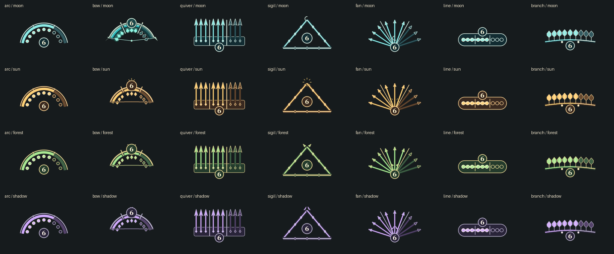

# Hunter Focus Arc

Индикатор фокуса охотника для **The Lord of the Rings Online**: 7 форм, 4 стиля, перемещение, масштабирование и поворот. Плагин показывает текущее значение фокуса и девять делений группами по три.

## Установка

1. Скачайте архив `HunterFocusArc-vX.Y.Z.zip` из раздела **Releases**.
2. Распакуйте его в `Документы/The Lord of the Rings Online/Plugins`. После распаковки файл `HunterFocusArc.plugin` должен находиться внутри папки `Plugins/HunterFocusArc`.
3. В игре откройте **Менеджер плагинов** и загрузите **Hunter Focus Arc** персонажем класса «Охотник».

Откройте вкладку **Настройки**, чтобы выбрать форму и стиль или изменить размер и угол. Команды и управление мышью описаны в [подробной инструкции](README-ru.md).

## Выпуск новой версии

1. Обновите `Version` в `HunterFocusArc.plugin` и внесите изменения в Git.
2. Проверьте архив локально: `python scripts/package_release.py --tag vX.Y.Z`.
3. Создайте и отправьте тег `vX.Y.Z` на соответствующем коммите. GitHub Actions проверит версию, соберёт ZIP с папкой `HunterFocusArc` и создаст релиз с архивом и SHA-256.

Первый релиз текущей версии: `v1.10.0`.
